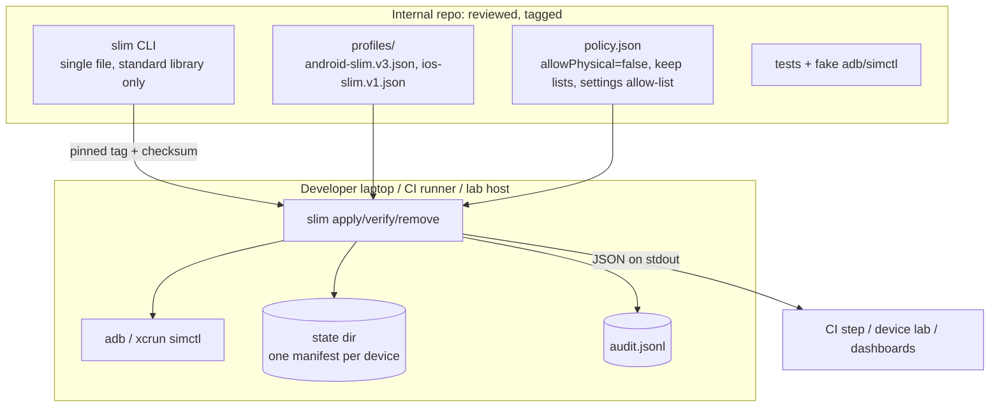

# Slim virtual devices for any organisation: architecture of a self-owned version

Status: design only, 2026-11-28. Written for any organisation that runs Android emulators or iOS simulators for development and CI, **with or without Mobile Hub**. Mobile Hub's built-in design is in `architecture-mobile-hub.md`. Governance, supply chain and rollout policy are in `enterprise-adoption-plan.md`; this file is the technical design that those policies apply to.

The aim is a slimming tool an organisation **owns outright**:

- no third-party code, and no downloads at run time;
- only the vendor tools it already trusts;
- small enough to review in an afternoon;
- every change recorded, verified, and undone exactly.

"Risk-free" means no unowned risk: section 12 lists what remains.

---

## 1. Why build instead of adopting

| Option | Problem for an organisation |
|---|---|
| Install the public tools as published (package taps, `@latest`, third-party CI actions) | Unpinned code from outside; a dependency tree to review (for example, one iOS tool's CLI brings in 20 Go modules); behaviour tied to someone else's release cadence |
| Fork and build internally | Owning a fork of code you did not design, including any parts that write undocumented OS stores directly |
| **Build a small, self-owned tool on vendor commands** | Some effort up front (§11). After that, every line is the organisation's own, reviewed, and limited to documented commands |

The public tools remain useful **as references**: their measurements and package lists are facts worth reading, and their limitation lists tell you which services to keep. Check the licence before copying any list verbatim.

## 2. Scope

**In:**

- Android emulators: disable packages; change reversible settings; health check; roll back.
- iOS simulators (macOS): disable launchd services through `simctl spawn … launchctl`; reboot; read back.
- A plan (dry run), apply, verify, remove, measure and status for each device.
- An audit log; machine-readable output for CI and for any device lab.

**Out:**

- Physical devices, unless a separate signed-off policy says otherwise.
- Host changes: SDK and Xcode are never modified; no shims; nothing installed system-wide.
- Data deletion.
- Emulator launch flags and snapshots. Those belong to whatever already starts the emulators (CI scripts, a device lab); see §9.

## 3. Threat model

| Asset | Threat | Control |
|---|---|---|
| Build and CI integrity | Tampered tool or profile | Tool and profiles live in an internal repo with code review and signed tags. CI runs a pinned tag and checks its checksum. |
| Test-result trust | Slim-caused failures, or false passes | Every result carries the profile name, version and manifest hash. Release gates exclude slim runs. |
| Shared devices | A device changed under someone | Virtual devices only. A per-device lock file (or the lab's own lock). Refused while a test process holds the device. |
| Host machines | Tool edits SDK or OS | The tool only calls `adb` and `xcrun simctl`, and only for the device serial or udid it was given |
| Command injection | Names reaching a shell | argv arrays only. Package and label names validated by regex. Profiles never come from user input at run time. |
| Data | Exfiltration | No network access at all. The tool makes no outbound calls, which can be checked during the pilot. |
| Availability | A device wedged by a disabled service | Health check with automatic rollback. Emulators and simulators can always be wiped as a last resort. |

## 4. Components



**Language choice.** One file, **standard library only**, in a language the organisation already runs:

- **Node.js** (`node:child_process`, `node:fs`, `node:crypto`): the natural choice where Appium or JavaScript test stacks are in use. It needs Node on the host.
- **Go**, standard library only: a single static binary, with nothing at run time. It needs a Go toolchain to build, and a binary to distribute and sign.
- **Avoid shell scripts:** quoting, error handling and JSON output make them the riskiest of the three.

Whatever the language: no third-party packages, so the bill of materials is the language runtime and the vendor tools.

## 5. Profile and policy files

**Profile** (`profiles/android-slim.v3.json`), versioned by its file name and content hash:

```json
{
  "name": "android-slim",
  "version": 3,
  "platform": "android",
  "minApiLevel": 30,
  "packages": {
    "default": ["com.android.vending", "com.google.android.youtube"],
    "35": ["com.google.android.apps.wellbeing"]
  },
  "settings": [
    { "namespace": "global", "key": "window_animation_scale", "value": "0" }
  ],
  "healthCheck": { "rebootAfterApply": true, "bootTimeoutSec": 120 }
}
```

**Policy** (`policy.json`): the organisation-wide rules a profile cannot override.

```json
{
  "allowPhysical": false,
  "keepAlways": {
    "android": ["com.google.android.gms", "com.android.bluetooth", "com.android.systemui"],
    "ios": ["com.apple.sharingd"]
  },
  "settingsAllowList": ["global/window_animation_scale", "global/transition_animation_scale", "global/animator_duration_scale"],
  "requireHealthCheck": true,
  "stateDir": "~/.slim/state",
  "auditLog": "~/.slim/audit.jsonl"
}
```

Profile changes go through code review, with a named owner who signs off (§10). The CLI refuses:

- a profile that names a `keepAlways` entry;
- a setting that is not on the allow-list;
- a profile with no `version`.

## 6. Commands

| Command | Does | Changes the device |
|---|---|---|
| `slim plan <profile> --device <serial\|udid>` | Reads the device and prints exactly what would change, what would be skipped, and why | No |
| `slim apply <profile> --device …` | Applies with read-back, health check and rollback; writes the manifest and audit entry | Yes |
| `slim verify --device …` | Compares the device with its manifest: `ok`, `drifted` (with the list) or `stock` | No |
| `slim remove --device …` | Undoes exactly the manifest, reads back, runs the health check | Yes |
| `slim measure --device …` | Guest memory (`dumpsys meminfo` / `footprint`), host process RSS, idle CPU over N seconds | No |
| `slim status [--all]` | Lists devices with manifests | No |

All commands print one JSON object on stdout (`--human` for a table) and exit with a documented code:

| Code | Meaning |
|---|---|
| 0 | OK |
| 2 | Refused by policy |
| 3 | Partly failed, but healthy |
| 4 | Health check failed, rolled back |
| 5 | Rollback incomplete. A person is needed |

## 7. Core algorithms

**Apply (Android):**

1. Gates, checked in this order:
   - the device is an emulator (`ro.kernel.qemu=1`, or the serial is `emulator-*`) unless the policy allows physical devices;
   - API level ≥ `minApiLevel`;
   - no manifest exists yet;
   - the lock is free.
2. Baseline: the full `pm list packages` and `pm list packages -d` output, and `settings get` for each setting (where "null" means unset).
3. For each package in `packages.default` plus `packages.<api>`, minus `keepAlways`:
   - skip with a reason if it is not installed or already disabled;
   - otherwise run `pm disable-user --user 0 <pkg>`, then read back with an **exact whole-line** match in the full disabled list.
4. For each setting: record `before`, run `settings put`, read back with `settings get`.
5. Health check: reboot; wait for `sys.boot_completed=1` within the timeout; check the launcher activity is resumed.
6. If healthy: write the manifest (only what was changed, with `before` values) and the audit entry; exit 0, or 3 if some items failed.
7. If not healthy: roll back in reverse order, run the health check again, write an audit entry; exit 4, or 5 if the rollback was incomplete.

**Remove:** reverse the manifest entries (`pm enable`; `settings put <before>` or `settings delete`), read back, health check, delete the manifest. A partial removal keeps the manifest, holding only the entries still changed.

**iOS:** the same shape, with these commands:

- `xcrun simctl spawn <udid> launchctl disable system/<label>`;
- a reboot through `simctl shutdown` and `simctl boot` plus `simctl bootstatus -b`;
- read back with `launchctl print-disabled system`.

Refuse runtimes where the change does not persist across a reboot. Never write the launchd override store directly, and never act on a simulator that was not named on the command line.

**The manifest** (`stateDir/<host>/<serial-or-udid>.json`) contains:

- `profile`, `version`, `profileSha256`, `toolVersion`;
- `platformVersion`, `appliedAt`, `appliedBy`;
- `changes[]`, `skipped[]`, `metrics.before` and `metrics.after`;
- `manifestHash`.

## 8. Audit log

`audit.jsonl` has one line per command that changes or verifies a device:

```json
{"at":"2026-11-28T10:00:00Z","user":"ci-runner-7","host":"runner-7","device":"emulator-5554","cmd":"apply","profile":"android-slim","version":3,"result":"ok","changes":41,"skipped":4,"failed":0,"manifestHash":"…","toolVersion":"1.2.0"}
```

CI uploads the manifest and audit lines as build artifacts. A central log pipeline can collect them as it would any other JSON log.

## 9. Integration patterns

| Where | How |
|---|---|
| **CI pipeline** | The step after "boot emulator" runs `slim apply android-slim --device $SERIAL`; the test step reads `slim verify --json`; the result-publishing step attaches the profile and `manifestHash` to the test report. Release pipelines omit the apply step, and **fail** if `verify` reports anything other than `stock`. |
| **Developer laptop** | Opt-in only: `slim apply` on a named emulator. The same CLI and the same profiles, so a laptop and CI behave the same. |
| **A device lab (any)** | The lab calls `slim apply/remove` as a device job and `slim verify` as a run preflight, then stores the JSON. Mobile Hub's design (`architecture-mobile-hub.md`) is one example. |
| **Snapshots** (where emulators are already started by scripts) | Apply once, save a snapshot named `<image>-slim-v3`, and boot from it read-only (`-no-snapshot-save`). Verify after every boot, because a snapshot can silently drift from the profile version. |
| **Test reporting** | Add `deviceProfile` and `manifestHash` to the report metadata (JUnit properties, Allure environment, or the lab's own model) |

## 10. Governance and lifecycle

| Activity | Owner | When |
|---|---|---|
| Profile changes | Mobile platform team; reviewed by a second engineer | Pull request with before/after `measure` numbers |
| OS qualification | Mobile platform team | Every new Android API level or Xcode/runtime release: run `plan`, `apply`, the health check and a smoke suite on the new image before the CI image moves |
| Tool releases | Mobile platform team | Signed tag, checksum published internally, changelog |
| Release-gate policy | QA or release owner | Slim tiers never count; enforced by the release pipeline's `verify` check |
| Incident handling | Whoever owns CI health | Exit codes 4 or 5 page the owner; the rollback is in the audit log |
| Decommission | Platform team | `slim remove --all` from manifests, then delete profiles. The state directory shows anything left over. |

**Profile versioning:** a version is immutable once released. A change means a new version. Runs record the version and the hash, so old results stay explainable.

## 11. Rollout plan and effort

| Phase | Scope | Exit criterion | Effort (one engineer) |
|---|---|---|---|
| R0 | Measure stock vs hand-slimmed on the organisation's real images and hosts | At least 25 % saving, or stop | 0.5–1 day |
| R1 | CLI: Android `plan`, `apply`, `verify`, `remove`, `measure`; policy and profile validation; fake-adb tests | Mutation-tested gates and read-back; live on two API levels | 4–5 days |
| R2 | CI integration: pinned tag, checksum, artifacts, release-pipeline `verify` = stock | One team's inner-loop CI on slim for 2 weeks with no unexplained failures | 2 days + 2 weeks soak |
| R3 | Broader rollout and dashboards: tier split, slim-only failure label | Release dashboards exclude slim runs | 2–3 days |
| R4 | iOS: Mac spike to confirm persistence through `simctl spawn launchctl`, then the iOS runner | Spike passes on the target runtimes, or iOS stays out | 1 day spike + 3 days |

Ongoing cost: about half a day per new Android API level or Xcode release to qualify profiles. Plan for it, or the profiles go stale.

## 12. Residual risks (what "risk-free" still leaves)

1. **Behaviour differs from real devices.** This is inherent. It is contained by tiers and `requiresStock` suites, not removed.
2. **Vendor command behaviour can change** (`pm`, `settings`, `launchctl` semantics). The read-back catches silent no-ops; qualification catches the rest before rollout.
3. **Profiles can be wrong.** Review, `keepAlways` and the health check reduce the risk; the audit log makes it visible.
4. **iOS persistence through documented commands is unproven** on every runtime. Phase R4 starts with a spike for that reason.
5. **People can bypass the tool** (manual `adb` changes). `verify` before each run catches it.
