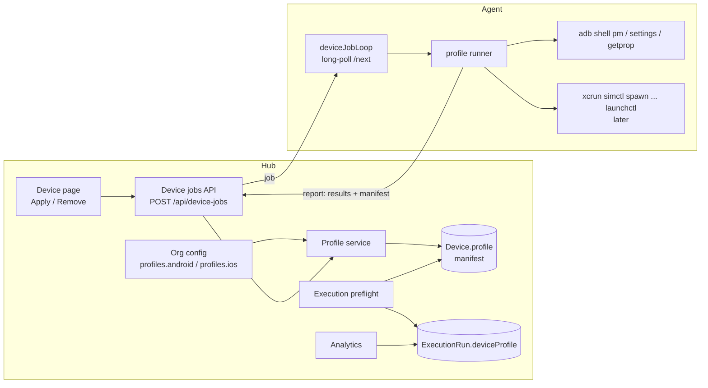

# Slim virtual devices in Mobile Hub: architecture of our own version

Status: design only, 2026-11-28. It is **not scheduled** and is kept apart from the main plan (`docs/reconciliation-plan-2026-11.md`) on purpose; nothing here is built. The analysis and verdicts behind it are in `feasibility.md`. The design for organisations that do not run Mobile Hub is in `architecture-any-organisation.md`.

"Risk-free" is the goal. In practice no change to a device is risk-free, so the design aims for **every risk named, bounded and visible**. Section 13 lists what still remains.

---

## 1. Goals and non-goals

**Goals**

1. Fit 3–5 times more Android emulators (and, later, iOS simulators) on one host, by switching off background services they do not need for testing.
2. Do it with **no new third-party dependency**: only the vendor tools the lab already needs (`adb`; later `xcrun simctl`).
3. Make it **opt-in, reversible, verified and recorded**: no change that is not read back, and no test run that does not say which profile it ran on.
4. Keep release decisions on stock and physical devices (a tiered testing policy).

**Non-goals**

- Physical phones. Never by default; see §9.
- Changing the host, the Android SDK or Xcode (no shims, no wrappers, no edits to tools we do not own).
- Deleting data (no disk-cleaning feature).
- Emulator launch flags (`-lowram`, `-gpu host`) and golden snapshots. These need the agent to start and stop emulators, which is a separate, later capability (§12, phase S4).

## 2. Principles

| # | Principle | Why it matters |
|---|---|---|
| P1 | Vendor tools only (`adb`, `xcrun simctl`), argv arrays, never a shell string | No supply chain to review; no injection |
| P2 | Profiles come only from admin-edited config, never from a request body | A caller cannot disable an arbitrary package |
| P3 | Virtual devices only (`connectionType` `emulator` or `simulator`) | A shared physical phone is never changed under someone |
| P4 | Every change is read back from the device | `pm disable-user` and `launchctl disable` can report success and do nothing |
| P5 | The **manifest of what actually changed** is stored, and removal undoes exactly that | Undo never guesses, and never touches what was already off before |
| P6 | A health check after applying, with automatic rollback | A disabled package that hangs the device is undone without a person |
| P7 | The device lock is required, as for every other device job | No change in the middle of someone's run or install |
| P8 | Every run is stamped with the device's profile | A slim-only failure is never read as an app bug |
| P9 | `stock` is the default, everywhere | Nothing changes unless someone asks |
| P10 | Idempotent: applying the same profile twice is a no-op; a different profile is refused until the current one is removed | No stacked, half-known state |

## 3. Where it sits



It reuses what already exists:

| Existing piece | Reused for |
|---|---|
| Device jobs (`backend/src/modules/device-jobs`): queue, claim, report, timeouts, lock checks, idempotency keys, dry run | Applying and removing a profile is a new action kind on the same pipeline |
| `deviceActionSchema` (`backend/src/common/device-actions.ts`) | New `profile` kind, validated with zod |
| Agent job loop and serialization per udid (`agent/agent.ts`) | Runs the profile runner, one job per device at a time |
| Org config (`config/org-config.schema.ts`, `mobilehub.org.yaml`) | Where profiles live, admin-edited and reviewed |
| Device model (`modules/devices/device.model.ts`) | `profile` subdocument |
| Run model (`execution-run.model.ts`) | `deviceProfile` stamp |
| Phase 5 heartbeat metrics (planned) | Before/after memory and CPU |

## 4. Profile format (org config)

```yaml
profiles:
  android:
    slim:
      version: 3                     # bump on every change; stamped on runs
      description: Inner-loop emulators. Not for release testing.
      minApiLevel: 30
      packages:                      # disabled with `pm disable-user --user 0`
        default:                     # applies to every API level unless overridden
          - com.android.vending
          - com.google.android.apps.photos
          - com.google.android.youtube
        "35":                        # extra entries for one API level
          - com.google.android.apps.wellbeing
      keep:                          # never touched, even if listed above
        - com.google.android.gms     # most apps need Play services
        - com.android.bluetooth      # hung boot on one API level when disabled
      settings:                      # each one reversible; the old value is recorded
        - { namespace: global, key: window_animation_scale, value: "0" }
        - { namespace: global, key: transition_animation_scale, value: "0" }
        - { namespace: global, key: animator_duration_scale, value: "0" }
      healthCheck:
        rebootAfterApply: true       # strongest check; adds about 30 s
        bootTimeoutSec: 120
  ios:                               # used only once the agent supports iOS
    slim:
      version: 1
      minRuntime: "18.5"
      daemons:
        "18.5": [com.apple.photoanalysisd, com.apple.mediaanalysisd]
      keep: [com.apple.sharingd]
```

Validation, at config load (zod):

- package names match `^[a-zA-Z][a-zA-Z0-9_]*(\.[a-zA-Z0-9_]+)+$`; launchd labels match `^[a-zA-Z0-9._-]+$`;
- `keep` wins over `packages`; a name in both is a config warning;
- the settings `namespace` is one of `global`, `secure`, `system`;
- settings keys are on an allow-list of keys known to be reversible (animation scales, `background_process_limit` is **not** on it: it changes app behaviour, so it needs its own opt-in);
- a profile with no `version` is refused.

## 5. Data model

**`Device.profile`** (null means stock):

```ts
profile: {
  name: string;               // 'slim'
  version: number;            // from config at apply time
  state: 'applied' | 'drifted' | 'applying' | 'removing' | 'failed';
  appliedAt: Date;
  appliedBy: string;          // user id
  platformVersion: string;    // API level or runtime when applied
  changes: Array<
    | { kind: 'package'; id: string; before: 'enabled'; after: 'disabled-user' }
    | { kind: 'setting'; namespace: 'global' | 'secure' | 'system'; key: string; before: string | null; after: string }
    | { kind: 'daemon'; label: string; before: 'enabled'; after: 'disabled' }
  >;
  skipped: Array<{ id: string; reason: 'not-installed' | 'already-disabled' | 'kept' | 'cannot-disable' }>;
  manifestHash: string;       // sha256 of the sorted changes; stamped on runs
  metrics: { before: Metrics | null; after: Metrics | null };
} | null
```

Two details carry most of the safety:

- `changes` holds only what **we** changed. A package that was already disabled is in `skipped`, and removal leaves it disabled.
- `before` holds the old value of every setting, including "unset" (`null`). Removal restores that exact value, or deletes the key.

**`ExecutionRun.deviceProfile`**: `{ name, version, manifestHash, state } | null`, copied at run start. It is never recomputed later.

**Device job action**:

```ts
z.object({ kind: z.literal('profile'), op: z.enum(['apply', 'remove', 'verify']), name: z.string().min(1).max(64) })
```

The job carries only the profile **name**. The hub resolves the name to the full list from config and sends that list to the agent in the claimed job. A caller cannot add a package.

## 6. Apply flow (Android)

```mermaid
sequenceDiagram
  participant U as Operator
  participant H as Hub
  participant A as Agent
  participant D as Emulator
  U->>H: POST /api/device-jobs {profile, apply, slim} (holds lock)
  H->>H: checks: role, lock holder, not busy, emulator, profile exists, API level >= min, device stock
  H->>H: Device.profile.state = applying; job queued with resolved list
  A->>H: GET /next (claims job)
  A->>D: baseline: pm list packages -d, pm list packages, settings get (each key)
  A->>D: metrics before (dumpsys meminfo, emulator RSS, CPU 60 s)
  loop each package not kept / not missing / not already disabled
    A->>D: pm disable-user --user 0 <pkg>
    A->>D: pm list packages -d (exact line match "package:<pkg>")
  end
  loop each setting
    A->>D: settings put <ns> <key> <value>; settings get (must equal)
  end
  A->>D: health check (reboot, wait sys.boot_completed=1, launcher resumed)
  alt healthy
    A->>D: metrics after
    A->>H: report succeeded + manifest + metrics
    H->>H: Device.profile = applied
  else unhealthy or timeout
    A->>D: rollback: pm enable each changed pkg; restore each setting; reboot
    A->>H: report failed + what was rolled back
    H->>H: Device.profile = null (or failed if rollback incomplete)
  end
```

Rules inside the runner:

- **Exact read-back.** `pm list packages -d` is a prefix match when given an argument (a recorded lesson). The runner lists everything and compares whole lines.
- **Per-item results.** `disabled`, `skipped` (with a reason) or `failed`. One failure does not stop the rest. Any `failed` turns into rollback only if the health check also fails. Otherwise the job succeeds with warnings, and the manifest is exact.
- **Timeouts.** Each `adb` call 15 s. The whole job is bounded by the device job run timeout, raised for this kind to 5 minutes, because a reboot is involved.
- **The job survives an agent restart as interrupted.** On the next claim for that device, the hub asks the agent for a `verify` first, because a half-applied state must be read from the device, not assumed.

## 7. Remove flow

1. Lock and busy checks, as for apply.
2. For each `changes` entry, in reverse order: `pm enable` (and read back), or restore the setting to `before` (`settings delete` when `before` is null).
3. Health check (reboot when the profile asked for one).
4. `Device.profile = null`. Items that could not be restored are reported by name, and the device stays in `failed` with them listed. It is never reported as stock while something is still changed.

## 8. Drift detection

A slim device can return to stock without us: an emulator wipe, a cold boot from a clean image, a system update. And a stock device can be changed by hand.

- **`verify`** compares the device with the manifest: every changed package still disabled, and every setting still at its `after` value.
- It runs in **execution preflight** before every run on a device with a profile. The result is stamped on the run. A mismatch sets `state: drifted`. The run continues but says "drifted" (configurable: `profiles.onDrift: warn | refuse`).
- It can also be run on demand from the device page.

## 9. Safety gates (enforced on the hub, before anything is queued)

| Gate | Error |
|---|---|
| Caller is operator or admin and holds the device lock | 403 / `DEVICE_NOT_HELD` (existing) |
| Device not executing and not installing | `DEVICE_BUSY` (existing) |
| `connectionType` is `emulator` (Android) or `simulator` (iOS) | `PROFILE_VIRTUAL_ONLY` |
| Profile exists for the platform; device API level or runtime ≥ minimum | `PROFILE_UNKNOWN` / `PROFILE_UNSUPPORTED_VERSION` |
| Apply: device is stock. Remove: device has this profile | `PROFILE_CONFLICT` |
| The feature is switched on (`features.slimProfiles`, off by default) and enforced server-side | 404, the same as other switched-off modules |

**Physical devices.** The only way to allow them is an org setting, `profiles.allowPhysical: true`, together with an admin-only role. It is deliberately not in this design's first phases. A disabled package on a shared phone surprises the next person.

## 10. Run integration and tiered testing

- **Preflight:** verify the profile, then stamp `deviceProfile` on the run.
- **Run page and report:** a "Slim profile v3" badge next to the device, linking to the manifest.
- **Device selection:** a `profile` filter (`stock`, `slim`, `any`). Suites can declare `requiresStock: true` (for example push or in-app purchase suites), and the hub refuses to schedule them on a slim device.
- **Analytics:** pass rates split by tier. Org config sets `releaseTiers: [stock, physical]`, and release dashboards count only those.
- **Failure triage:** when a test fails on slim and passed on stock in the last N runs, the failure is labelled "slim-only", not "regression".

## 11. iOS (only after the agent supports iOS simulators)

Our own version uses **documented commands only**. It never writes the simulator's launchd override store directly, which is the undocumented part.

| Step | Command |
|---|---|
| Runtime check | `xcrun simctl list runtimes -j`: refuse below `minRuntime`, because older runtimes forget the change on reboot |
| Disable | `xcrun simctl spawn <udid> launchctl disable system/<label>` (argv; label validated) |
| Apply | `xcrun simctl shutdown <udid>` then `xcrun simctl boot <udid>`; wait with `xcrun simctl bootstatus <udid> -b` |
| Read back | `xcrun simctl spawn <udid> launchctl print-disabled system` (exact label match, `=> disabled`) and `launchctl print system/<label>` (not running) |
| Remove | `launchctl enable system/<label>` for each changed label, then reboot and read back |
| Scope | Only simulators the agent itself lists as lab-owned. Never all simulators on the Mac. |

Unvalidated: we have no Mac in the lab. Before phase S5 starts, a spike on a Mac must confirm that `launchctl disable` through `simctl spawn` persists across a simulator reboot on the target runtimes. If it does not, the iOS part stops there. It does not fall back to writing the store directly.

The label lists are per runtime, start small, and grow only with labels measured to matter. The known breakage list (push, in-app purchase testing, universal links, App Clips) maps to labels that stay in `keep`, unless a profile opts out of them on purpose.

## 12. Phases

| Phase | Scope | Done when | Effort |
|---|---|---|---|
| S0 | Measure the dev emulator stock, then with the candidate list disabled by hand (guest `dumpsys meminfo` total PSS, emulator process RSS, idle CPU over 60 s). Go or no-go. | Numbers in `docs/slim-devices/measurements.md`; go only if the saving is at least 25 % | 0.5 day |
| S1 | Config schema; `profile` job kind; Android runner (apply, remove, verify); manifest; gates; rollback | Mongo-backed and unit tests; mutation checks; live apply, verify and remove on the dev emulator with exact read-back; a forced health failure rolls back | 3–4 days |
| S2 | Run stamping; preflight verify; device page badge and controls; run page badge | A run on a slim device shows the profile; a wiped emulator shows "drifted" | 2 days |
| S3 | Device selection by profile; `requiresStock`; analytics split; slim-only failure label | Release dashboard excludes slim runs | 2–3 days |
| S4 | Managed emulators (start, stop, golden snapshot, launch flags per host): a separate capability with its own design | Its own document | — |
| S5 | iOS, after iOS support exists: spike on a Mac, then the runner from §11 | Spike confirms persistence; same tests as S1 | 3 days after the spike |

## 13. Failure modes and residual risks

| Failure | What happens | Residual risk |
|---|---|---|
| A package name changes in a new API level | It is reported `skipped: not-installed`; nothing breaks | The saving shrinks silently. Mitigation: the job result shows the skip count, and the metrics show the saving. |
| A disabled package hangs boot | The health check fails, rollback runs, the job fails with the package list | Rollback itself needs `adb` to respond. If the emulator is fully wedged, it is marked `failed`, and the fix is a cold boot or wipe (emulators only, so no user data is lost). |
| `pm disable-user` returns 0 but does nothing | The read-back catches it: `failed` for that package | None |
| An app under test needs a disabled service | The test fails on slim and passes on stock: "slim-only" label | A person must still read the label. Suites declare `requiresStock` where it is known. |
| Memory behaviour differs from real devices | — | Inherent. Never measure performance or memory on slim devices (`requiresStock` for those suites). |
| The agent restarts mid-apply | The job is interrupted; the next action on the device starts with `verify` | None beyond a delay |
| Someone changes the device by hand | Preflight verify marks it `drifted` on the next run | Changes between runs are only seen at the next run |
| Config is edited to include a harmful package | Config review (it is a reviewed file); `keep` list; virtual devices only; health check | Depends on config review discipline |

## 14. Testing strategy

- **Unit:** parsers (`pm list packages` lines, `settings get` with `null`, `getprop`, `launchctl print-disabled`), the manifest diff, and the order of rollback.
- **Agent with a fake adb:** a stub that records argv and returns scripted output. Proves there are no shell strings, exact read-back, per-item results, and rollback on a failed health check.
- **Hub, against MongoDB:** gates, the state machine, run stamping, drift.
- **Mutation checks** on every gate and on the read-back comparison.
- **Live:** dev emulator apply, verify, remove; a forced health failure (a test-only profile that disables the launcher) must roll back.
- **CI:** unit and Mongo tests only. Emulator tests stay a documented manual step, as today.
